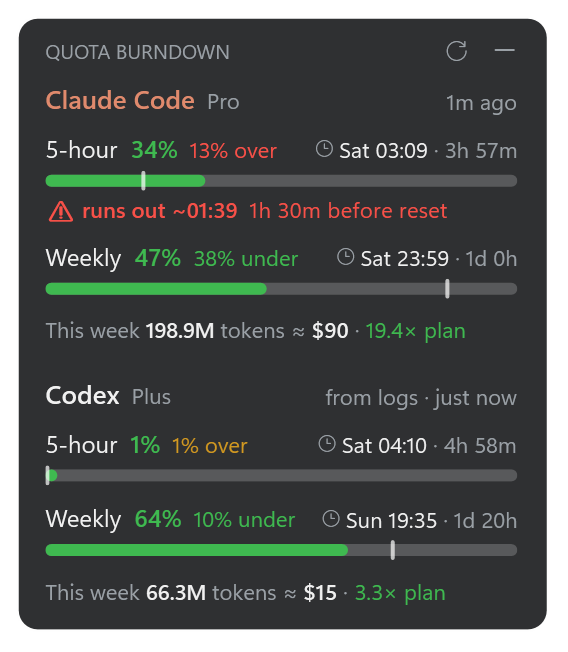
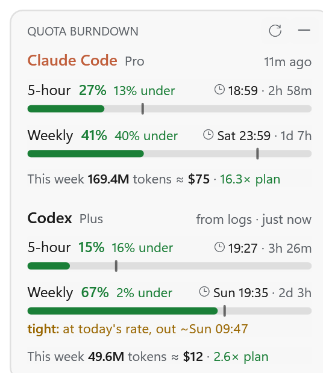
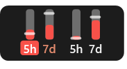
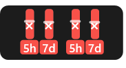
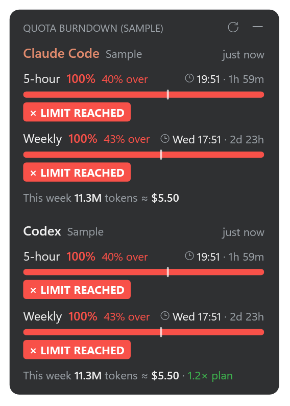

# Quota Burndown

**A burndown chart for your Claude Code, Codex, and Gemini limits.**

<br clear="left">

[](https://github.com/mondrikrob/quota-burndown/actions/workflows/ci.yml)
[](https://github.com/mondrikrob/quota-burndown/releases/latest)
[](LICENSE)

[Download for Windows](https://github.com/mondrikrob/quota-burndown/releases/latest) · [Install options](#install) · [Security details](SECURITY.md)

A small Windows desktop widget and taskbar strip that show your **Claude Code**, **OpenAI Codex**, and **Google Gemini** (Antigravity / Gemini CLI) usage limits for the **5-hour** and **weekly** windows. For each window it also shows:

- your pace,
- when you'll run out at your current rate,
- how many tokens you've burned,
- what those tokens would have cost on the pay-as-you-go API.

It's a single PowerShell script with no additional runtime to install: it uses Windows PowerShell 5.1 and the Windows desktop libraries that ship with Windows 10 and 11. You still need at least one supported provider signed in; see [Requirements](#requirements).

<p>
  
  
</p>

Taskbar strip: 

At 100% (sample data): 

<details>
<summary>See the widget's limit-reached state (sample data)</summary>

</details>

## Why

"You've used 62% of your weekly limit" doesn't tell you much on its own. Is that a lot for Thursday evening? Will you run dry on Saturday, or is there room to start a big refactor now? Quota Burndown answers it the way a burndown chart does: it compares what you've used with where an even pace would put you, and projects your recent burn rate to the reset. It sits on the taskbar, so you see it without opening anything. It also shows how much your subscription is worth to you: what the same tokens would have cost on the pay-as-you-go API.

> **Unofficial.** This project is not affiliated with or endorsed by Anthropic, OpenAI, or Google. Provider interfaces and local log formats can change.

> **Claude integration is experimental.** It reads a Claude Code subscription token to query an undocumented endpoint. Anthropic's [authentication and credential-use policy](https://code.claude.com/docs/en/legal-and-compliance#authentication-and-credential-use) restricts third-party use of subscription credentials; no explicit allowance for this usage-monitoring approach has been verified. This project does not claim provider approval. Codex uses the documented [App Server interface](https://learn.chatgpt.com/docs/app-server). Gemini queries the local Antigravity language server (`GetUserStatus` / `RetrieveUserQuotaSummary`) over loopback (`127.0.0.1`) or Gemini CLI OAuth quota endpoints.

## Features

- **Banked resets.** Shows each provider's available reset count and next expiry in the widget and taskbar tooltip. Click the widget's reset line to open the provider's usage page. Windows notifications announce newly detected resets and warn once within the final 24 hours before expiry. Existing resets establish a baseline on first start; notification history prevents repeats after restarts. Toggle **Banked reset notifications** in the right-click menu. Missing reset information stays unknown, and stale/error readings do not generate alerts. Reminders arrive on the next successful refresh while the widget is running; Windows notification settings or Do Not Disturb may suppress them. Resets are applied manually on the provider's usage page.

- **Desktop widget.** Compact by design: two lines per window, with the details on hover.
  - **Each window:** % used, how far over or under the even pace you are (e.g. "9% under"), and when it resets (e.g. "🕒 Sun 19:35 · 2d 3h", shown with a clock icon). Below that is a bar whose white tick marks where an even pace would put you.
  - **Run-out warning:** appears only when it matters, based on your recent burn rate (the last hour for the 5-hour window, today for the weekly one):
    - **Red:** you're over the even pace *and* will run out well before the reset, e.g. "⚠ runs out ~17:21, 2h 38m before reset".
    - **Amber "tight":** you'd run out only shortly before the reset, or you're still under the even pace, e.g. "tight: at today's rate, out ~Sun 13:11".
  - **Limit reached:** at exactly 100%, a red **× LIMIT REACHED** label replaces the forecast warning for that window. It clears when the reset passes or a fresh reading reports less than 100%.
  - **Stale readings:** values over 15 minutes old are marked stale. Forecasts are withheld for stale readings, provider errors and Codex's session-log fallback.
  - **One summary line per tool:** this week's tokens burned (from local logs), what they'd cost at API list prices, and how that compares with your plan, e.g. "This week 163.8M tokens ≈ $74 · 16.0× plan".
  - **Hover over a row** for the even-pace %, the forecast ("~61% by reset"), its burn rate, the reset date, and the token breakdown (input / output / cache write / cache read).
- **Taskbar strip.** Six tiny signal bars sit next to the tray icons:
  - **5h** is the 5-hour window and **7d** is the weekly window. Orange labels are Claude Code, white labels are Codex, and blue labels are Gemini.
  - Red means used and grey means remaining. The white line is the even pace.
  - A red label pill means that window will run out before it resets. An amber outline means it's tight.
  - A **white × on a full red bar** means the last reading reported **100% used**. A **?** marks unavailable or stale data.
  - Click the strip to show or hide the widget, and drag it to move it along the taskbar.
- **Tray icon.** The app logo, with usage in its tooltip; exhausted windows say **FULL**. Click it to show or hide the widget, or right-click it for the menu.
- **Usage history.** New readings are appended to `history.csv`, ready for Excel or Power BI. Unchanged readings are recorded at most once every 30 minutes.
- **Themes.** Uses the Windows light/dark theme at startup, and the strip uses the taskbar's theme. Restart after changing the Windows theme.
- **The taskbar strip hides** when a fullscreen app is in front or the taskbar is auto-hidden. The desktop widget follows your visibility and always-on-top settings.

## Alternatives

Other tools also show usage limits. This one focuses on **pace and forecasting** in a **Windows taskbar strip**. Check their current documentation before comparing features:

| Tool | Platform | How it differs from Quota Burndown |
|---|---|---|
| [Win-CodexBar](https://github.com/nesszer/Win-CodexBar) | Windows tray (Tauri/Rust) | Broad provider coverage, usage cards, and provider settings in a tray panel. |
| [Claude Code Usage Monitor](https://github.com/CodeZeno/Claude-Code-Usage-Monitor) | Windows taskbar widget (Rust) | Another taskbar option, with multiple providers and accounts. |
| [CC Meter](https://pypi.org/project/ccmeter/) | Command line (Python) | Measures what a % of your limit is worth in dollars and tracks over time whether your cap is shrinking. A terminal tool, not a widget. |
| [Headroom](https://github.com/patwalls/headroom) | macOS menu bar | Claude Code session and weekly usage in the menu bar. |
| [BurnRate](https://tommcfarlin.com/burnrate-claude-code-usage/) | macOS menu bar | Mirrors Claude Code's `/usage` bars (session, week, Opus, Sonnet). Mac only. Its author has since recommended Claude Code's status line instead. |

What Quota Burndown adds: the **even-pace target** for every window, a **run-out forecast** from your recent burn rate, **tokens burned and their API value compared with your plan's price**, Claude Code, Codex, and Gemini side by side, a **`history.csv`** you can analyse, and a single readable script with no install or dependencies. What it lacks: other providers, multiple accounts, macOS and Linux.

## Requirements

- Windows 11, or Windows 10 version 1809 or newer.
- **Claude Code**, signed in with a Claude subscription (Pro or Max), for the Claude Code numbers.
- **Codex**, signed in with ChatGPT (the Codex desktop app, or the CLI from npm or elsewhere on `PATH`), for the Codex numbers.
- **Google Antigravity** (running locally) or **Gemini CLI** (`~/.gemini/oauth_creds.json`), signed in with a Google AI subscription (Pro or Ultra), for the Gemini numbers.

Any provider alone is fine; unused sections just show "not found".

## Install

Pick one. All three end with the same result: the script in `%USERPROFILE%\.quota-burndown`, **Quota Burndown** in the Start menu, and the widget running.

### Option 1: zip with a double-click installer

1. From the [latest release](https://github.com/mondrikrob/quota-burndown/releases/latest), download `QuotaBurndown-<version>.zip`.
2. Optional, but a good habit: [check its SHA-256](#verify-the-download).
3. Extract the whole zip to a normal folder, then double-click **`Install.cmd`**. If Windows warns that it came from the internet, run it only after checking the source and checksum. The installer:
   - runs `Unblock-File` on the `QuotaBurndown.ps1` next to it,
   - then runs `QuotaBurndown.ps1 -Install`.

   Open it in Notepad to check. If either step fails, it shows the error and stops. No administrator rights are required.

### Option 2: Scoop

If you use [Scoop](https://scoop.sh), this repository is also a Scoop bucket. The manifest pins the release URL and its SHA-256, so Scoop refuses a file that doesn't match.

```powershell
scoop bucket add quota-burndown https://github.com/mondrikrob/quota-burndown
scoop install quota-burndown/quota-burndown
QuotaBurndown -Install
```

To update, run `scoop update quota-burndown`, then `QuotaBurndown -Install` again.

### Option 3: just the script

1. Download `QuotaBurndown.ps1` from the [latest release](https://github.com/mondrikrob/quota-burndown/releases/latest) (or clone this repository) and read it. It's one file, and it's meant to be readable.
2. Unblock it (files downloaded from the internet are marked), then install:

   ```powershell
   Unblock-File .\QuotaBurndown.ps1
   powershell -NoProfile -ExecutionPolicy Bypass -File .\QuotaBurndown.ps1 -Install
   ```

   Run the same command again after updating the script.

### After installing

The first install asks three yes/no questions (all can be changed later in the menu):
- **Try Claude login renewal automatically (experimental)?** See [Claude login renewal](#claude-login-renewal) below.
- **Check for new versions once a day?** The widget then asks GitHub for the latest version number and shows a link if there's a newer one. Nothing is downloaded or installed automatically.
- **Start Quota Burndown when you sign in to Windows?** Defaults to **yes**; adds a shortcut to your Startup folder. Not asked if **Start with Windows** is already ticked in the menu.

The first two default to **no**.

`-ExecutionPolicy Bypass` only applies to that one PowerShell process; it doesn't change your system policy. The Start menu shortcut launches the script through `conhost --headless`, so no console window appears.

There are deliberately no `irm ... | iex` one-liners: you get a file you can read before running it. The script isn't code-signed. SHA-256 verifies that the download matches the published checksum; it does not prove the code is safe or protect against a compromised publisher account. Managed PCs may require a signed script under their organisation's policy.

### Verify the download

Each release lists the SHA-256 of every file in its notes and in `SHA256SUMS.txt`. Compare them with:

```powershell
Get-FileHash .\QuotaBurndown-1.7.0.zip -Algorithm SHA256
```

The hash must match exactly (`Get-FileHash` prints it in upper case; case doesn't matter).

## Using it

**Widget**
- **Move:** drag it.
- **Refresh:** double-click it, or use the refresh button.
- **Minimize:** the minimize button hides it so only the taskbar strip remains.
- **Keyboard:** Tab reaches the buttons; F5 refreshes, Escape hides the widget, and Shift+F10 opens the menu while the widget has focus.

**Right-click menu** (on the widget, the strip or the tray icon)
- Show/Hide widget
- Refresh now
- Always on top
- Show on taskbar
- Show on all taskbars (also on other monitors' taskbars)
- Reset taskbar position
- Start with Windows
- Try Claude login renewal (experimental)
- Check for updates daily
- Banked reset notifications
- Update available (only when there is one; opens the release page)
- Open data folder
- Exit

**Command line**

| Command | What it does |
|---|---|
| `QuotaBurndown.ps1 -Once` | Print the current numbers to the console and exit |
| `QuotaBurndown.ps1 -Snapshot out.png [-Theme dark\|light]` | Render the widget (and `out-strip.png`) to images |
| `QuotaBurndown.ps1 -Uninstall` | Stop the widget and remove its shortcuts and installed copy |

## How it works

| What | Source | How often |
|---|---|---|
| Claude Code limits | `GET https://api.anthropic.com/api/oauth/usage` with the OAuth token Claude Code stores in `~/.claude/.credentials.json` | every 5 min (cached on disk; honors `Retry-After`) |
| Codex limits | `codex app-server --stdio` → JSON-RPC `account/rateLimits/read`. If that fails, it falls back to the `rate_limits` entries in `~/.codex/sessions/**/*.jsonl` | every 3 min |
| Gemini limits | Local Antigravity `language_server` (`GetUserStatus` / `RetrieveUserQuotaSummary` over loopback), with fallback to Gemini CLI (`~/.gemini/oauth_creds.json`) and cached readings (`gemini-usage.json`) | every 3 min |
| Tokens burned | Parsed from `~/.claude/projects/**/*.jsonl`, `~/.codex/sessions/**/*.jsonl`, and `~/.gemini/antigravity/brain/**/.system_generated/logs/transcript.jsonl` (read incrementally) | every minute |
| Run-out forecast | Your burn rate from `history.csv`: the last hour for the 5-hour window, the last 24 h for the weekly one. If there isn't enough history yet, it uses the average since the window started | every minute |
| API value | Tokens × API list prices per model (table near the top of the data layer in the script) | every minute |

Notes:

- **The Claude usage endpoint is rate-limited.** If it answers 429, the widget waits as long as it's told (this can be up to an hour) and keeps showing the last numbers. Every 5 minutes has been fine in testing; if you see "rate limited" often, raise `ClaudeRefreshMinutes`.
- **Token counts only cover what's logged on this PC.** The % limits also include provider usage on other devices. A window can show a % used with few or zero local tokens. The API value is an estimate of the local records, not a complete account total.
- **API value is an estimate, not a bill or guaranteed saving.** It uses the script's static price table and ignores long-context surcharges, fast mode, batch discounts, taxes and other modifiers. Unknown models are counted but not priced; the widget then says **priced subtotal** and hides the plan comparison. Local logs can also omit usage or contain inherited session records. Prices need updating as providers change them.
- **Scope:** Codex currently shows the shared `codex` pool; additional model-specific pools are not shown. Scoped Claude quota rows show percentages and forecasts, but omit token totals rather than attribute every model's tokens to one scope. Gemini shows the shared `Gemini Models` 5-hour and weekly pools across Google AI Pro/Ultra (and ignores 3P Claude/GPT models inside Antigravity transcripts when counting Gemini tokens).
- **Antigravity must be open for live Gemini quota updates:** Antigravity consumer subscriptions (Google One AI Pro / Ultra) authenticate through Antigravity's local Electron host bridge, which runs `language_server.exe` on loopback `127.0.0.1`. When Antigravity is closed, the widget continues counting down towards your next reset time and displays your last cached quota snapshot (`gemini-usage.json`) until Antigravity is opened again (it can be kept minimized in the background).

## Claude login renewal

The Claude Code access token on your PC (in `~/.claude/.credentials.json`) can expire. The widget then shows **login expired**. The Claude desktop app uses a separate login, so signing in there does not necessarily restore the widget's access. You have two options:

- **Try the experimental renewal helper.** Answer yes at install, or tick **Try Claude login renewal (experimental)** in the menu. It runs `claude doctor`, an official diagnostics command that makes no model request. Some versions may renew the login as a side effect; this is not a documented or guaranteed renewal interface. The widget never writes the login file. Details in [SECURITY.md](SECURITY.md#automatic-login-renewal-opt-in).
- **Run `claude` in a terminal** and sign in if prompted when the widget says **login expired**, then exit it.

## Settings

Stored in `%USERPROFILE%\.quota-burndown\settings.json`. Restart the widget after editing (Exit, then reopen it from the Start menu).

| Setting | Default | |
|---|---|---|
| `ClaudeRefreshMinutes` | `5` | Minimum 5; raise it if you often see "rate limited" |
| `CodexRefreshMinutes` | `3` | |
| `GeminiRefreshMinutes` | `3` | |
| `ClaudePlanUsdPerMonth` | auto | Overrides the detected plan price (Pro $20, Max 5x $100, Max 20x $200) |
| `CodexPlanUsdPerMonth` | auto | Overrides the detected plan price (Plus $20, Pro $200) |
| `GeminiPlanUsdPerMonth` | auto | Overrides the detected plan price (Google AI Pro $20, Ultra $250) |
| `ClaudeAutoRenewLogin` | asked at install | Try `claude doctor` after login expiry; experimental, renewal not guaranteed; also in the menu |
| `CheckForUpdates` | asked at install (off) | Look for a newer release once a day; also in the menu |
| `BankedResetNotifications` | `true` | Notify about new banked resets and expiry within 24 hours; also in the menu |
| `StartWithWindows` | asked at install (on) | Start the widget at sign-in (Startup folder shortcut); use the menu item to change it |
| `Topmost`, `Visible`, `StripVisible` | `true` | Also available from the menu |
| `StripOffset` | `8` | Gap between the strip and the tray icons; drag the strip to change it |
| `StripAllTaskbars` | `false` | Also show the strip on the other monitors' taskbars; also in the menu |
| `Left`, `Top` | saved automatically | Widget position |

## Files

Everything lives in `%USERPROFILE%\.quota-burndown`. It's kept outside AppData on purpose: packaged (Store/MSIX) apps virtualise AppData writes.

| File | Contents |
|---|---|
| `QuotaBurndown.ps1` | Installed copy of the script |
| `settings.json` | Your settings |
| `claude-usage.json` | Last Claude usage response, so restarts don't re-query the rate-limited endpoint |
| `gemini-usage.json` | Last Gemini usage response, so quota numbers remain visible while Antigravity is closed |
| `banked-reset-notifications.json` | Observed reset identifiers/counts and expiry reminder history; contains no credentials |
| `update-check.json` | When the update check last ran and the latest version it saw (only if the check is on) |
| `history.csv` | Every usage reading: `timestamp_utc, tool, window, used_percent, resets_at_utc` |
| `widget.log` | Errors and warnings (rotated at 512 KB) |
| `quota-burndown.ico` | The logo, used for the tray icon and shortcuts (regenerated on start) |

## Privacy and security

See [SECURITY.md](SECURITY.md). In short:

- Direct widget requests contact `api.anthropic.com`, loopback `127.0.0.1` for the local Antigravity language server (or `cloudcode-pa.googleapis.com` if falling back to Gemini CLI), and optionally `api.github.com` for updates. The official Codex CLI and optional Claude diagnostics helper make their own network requests.
- The Claude access token is read from Claude Code's file and sent to `api.anthropic.com` over HTTPS. The widget does not write the credentials file or intentionally persist tokens to its cache or log.
- The widget has no telemetry of its own. Review diagnostics before sharing them.

## Troubleshooting

- **"login expired":** the Claude Code login on this PC has expired. Run `claude` once in a terminal, or turn on **Try Claude login renewal (experimental)** in the menu.
- **"login expired" with a retry time** (automatic renewal on): `claude doctor` ran but the login is still expired, for example because you were offline or Claude Code needs you to sign in again. The widget checks the login every minute and runs `claude doctor` again after 5 minutes (later every 30 minutes); or run `claude` in a terminal, which asks you to sign in if needed.
- **"rate limited":** the Claude usage endpoint asked to wait. The widget keeps showing the last values and retries after the requested time.
- **Codex "not found":** install the Codex desktop app, or make sure `codex.exe` is on `PATH`.
- **Codex shows "from logs":** the live query failed twice in a row (it retries once at once); you're seeing the latest values recorded in your Codex session logs. Hover over the status for the reason. `widget.log` says which step failed and after how long, for example "timed out after 30s waiting for rate limits" (Codex itself didn't answer) or "error sending request" (Codex couldn't reach its server).
- **Gemini shows "idle" or "cached":** live Gemini quota queries the running Antigravity `language_server.exe` on loopback (`127.0.0.1`). Antigravity must be running (can be kept minimized) for live queries. When Antigravity is closed, the widget shows your last cached reading (`gemini-usage.json`) while keeping the reset countdown timers running until you open Antigravity again.
- **Strip missing on a second monitor:** tick **Show on all taskbars**. On a secondary taskbar the strip sits left of the clock area; drag it if it covers something.
- **Nothing on the taskbar:** check **Show on taskbar** in the menu. The strip hides when the taskbar is auto-hidden or vertical, and when a fullscreen app is in front.
- **Anything else:** check `widget.log` (menu → **Open data folder**).

## Uninstall

```powershell
powershell -NoProfile -ExecutionPolicy Bypass -File "$env:USERPROFILE\.quota-burndown\QuotaBurndown.ps1" -Uninstall
```

If you installed with Scoop, also run `scoop uninstall quota-burndown`.

This removes the shortcuts and the installed copy. Delete `%USERPROFILE%\.quota-burndown` to remove settings and history too. Scoop's installed package is separate; remove it with `scoop uninstall quota-burndown`.

## FAQ

**Does it send my data anywhere?**
The widget sends your Claude Code access token to `api.anthropic.com` to fetch limits, and queries the local Antigravity language server on `127.0.0.1` for Gemini limits. The official Codex CLI makes its own network requests. Optional update checks contact `api.github.com`, without credentials. The widget does not upload your conversations or local history and has no telemetry of its own. See [SECURITY.md](SECURITY.md).

**Does checking the limits use up my quota?**
No. Reading the usage numbers doesn't run a model, so it costs no tokens. The Claude usage endpoint is rate-limited, though, which is why the widget asks at most every 5 minutes and backs off when told to.

**Why does it say "login expired"?**
The Claude Code access token can expire. Run `claude` in a terminal and sign in if prompted, or try the experimental diagnostics helper; see [Claude login renewal](#claude-login-renewal).

**Why are the token numbers so low compared with the %?**
The % counts everything on your account: claude.ai chats, the desktop and mobile apps, other PCs. The token numbers count only what Claude Code, Codex, and Antigravity logged on this PC.

**Does it work with an API key instead of a subscription?**
No. With a pay-as-you-go API key there are no 5-hour or weekly limits to show. You need a Claude Pro or Max subscription for Claude Code, a ChatGPT plan for Codex, or a Google AI Pro or Ultra plan for Gemini.

**Why PowerShell?**
It ships with every Windows PC, so there's nothing to install, and a single script is easy to read before you run it. That matters for a tool that touches your login.

**Can I analyse my usage in Excel or Power BI?**
Yes. Every reading is appended to `%USERPROFILE%\.quota-burndown\history.csv`: timestamp, tool, window, % used and reset time.

**Does it work on macOS or Linux?**
No, it uses Windows-only parts (WPF, the taskbar). See [Alternatives](#alternatives) for Mac tools.

## Tested on

| | |
|---|---|
| Windows | Windows 11 (ARM64) |
| PowerShell | Windows PowerShell 5.1 for the widget; the automated tests also run on PowerShell 7 |
| Taskbar | at the bottom, dark theme, single monitor |

Not tested yet: x64 PCs for the widget itself (the automated tests run on x64), taskbars on a second monitor (**Show on all taskbars**), a light taskbar on a real screen (only in rendered previews), and top taskbars. The strip hides itself when the taskbar is vertical. Reports are welcome.

### Windows 10

Reviewed in the code, not yet tested on a real Windows 10 PC:

- **Strip placement** works the same way: Windows 10's taskbar has the same tray area (`TrayNotifyWnd`) that the strip lines up against.
- **Short taskbars:** the default Windows 10 taskbar (40 px) and small taskbar buttons (30 px) are shorter than Windows 11's. The bars scale down to fit, so they get smaller there.
- **Fonts and icons:** Windows 11's Segoe UI Variable and Segoe Fluent Icons fall back to Segoe UI and Segoe MDL2 Assets, which include the same icons.
- **Start menu shortcut:** it uses `conhost --headless` to hide the console window, which needs Windows 10 version 1809 or newer.

## Development

`tests\` holds [Pester](https://pester.dev) tests for login-renewal behavior, response validation, exhausted limits, token accounting, bounded subprocess output, settings, history sanitising and forecasts. GitHub Actions runs them on every push, on Windows PowerShell 5.1 and PowerShell 7, together with a parse check and [PSScriptAnalyzer](https://github.com/PowerShell/PSScriptAnalyzer). CI pins Pester 5.7.1 and PSScriptAnalyzer 1.25.0; excluded style rules are explained in `PSScriptAnalyzerSettings.psd1`.

```powershell
Invoke-Pester -Path .\tests
```

See [CONTRIBUTING.md](CONTRIBUTING.md) for the ground rules. Releases are built with `tools\Build-Release.ps1 -Version x.y.z` (PowerShell 7). It creates the zip and `SHA256SUMS.txt` in `dist\` and pins the new hash in the Scoop manifest (`bucket\quota-burndown.json`).

## License

[MIT](LICENSE). Claude and Claude Code are trademarks of Anthropic; Codex and ChatGPT are trademarks of OpenAI.
